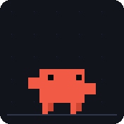
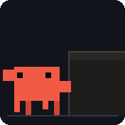

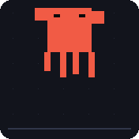
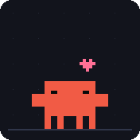
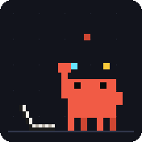
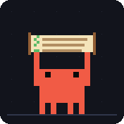
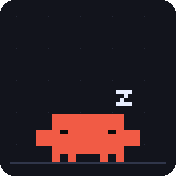
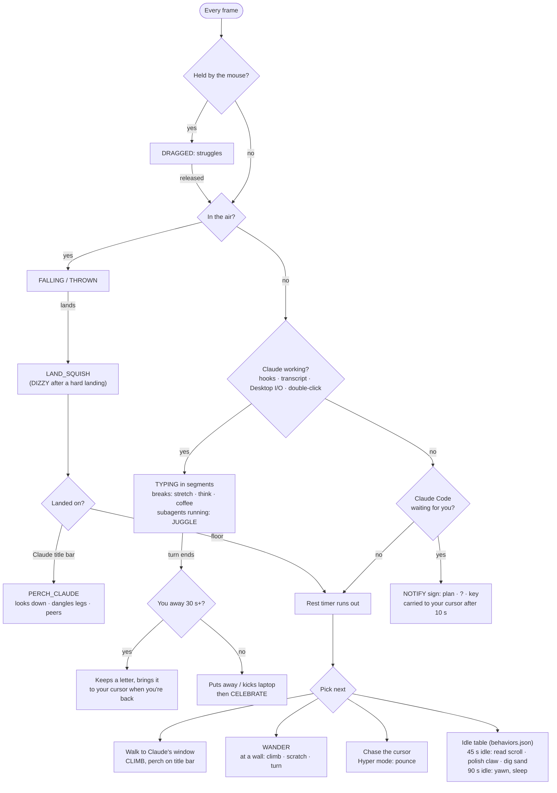

<p align="center"><b>English</b> | <a href="README.zh-TW.md">繁體中文</a></p>

# Clawdlet

```ts
let clawd = new WindowCompanion({ gravity: true });
```

> ***`let clawd` roam on your Claude Desktop.***
> **Clawdlet** is an unofficial, fan-made physics desktop pet that perches on your Claude Desktop window (`Claude.exe`).


---

## ✨ Introduction

Clawdlet is a small pixel-art Clawd that lives on your Windows desktop. It has gravity, knows where your Claude Desktop window is, and reacts to what Claude is doing.

<table>
  <tr>
    <td align="center"><br><sub>Strolls along the taskbar</sub></td>
    <td align="center"><br><sub>Climbs up and perches on Claude</sub></td>
    <td align="center"><br><sub>Types while Claude works</sub></td>
    <td align="center"><br><sub>Pick it up, throw it, it gets dizzy</sub></td>
  </tr>
  <tr>
    <td align="center"><br><sub>Rub the mouse over it to pet it</sub></td>
    <td align="center"><br><sub>Juggles while subagents run</sub></td>
    <td align="center"><br><sub>Holds up a sign when Claude needs you</sub></td>
    <td align="center"><br><sub>Dozes off when you're away</sub></td>
  </tr>
</table>

- **Window-aware**: finds your Claude Desktop window, walks over, climbs its side and sits on the title bar. Drag the window and Clawd rides along; shake it and Clawd gets flung off; minimize it and Clawd falls.
- **Works when Claude works**: while Claude is thinking (Claude Desktop I/O, Claude Code hooks or transcripts), Clawd pulls out a laptop and types in segments with breaks, then celebrates when the turn ends. In Hyper mode it kicks the laptop across the screen into an explosion.
- **Reacts to you**: its eyes follow the cursor; it can be poked, petted, picked up and thrown; it naps after 90 s without input.
- **Claude Code integration**: juggles while subagents run, molts on compaction, gets confused / sweaty / sad on tool failures, holds up a sign for plan reviews, questions and permission prompts, and leaves you a letter if a turn finishes while you're away.
- **Customizable**: three activity modes, 1x / 2x / 3x scale, click-through lock, and a JSON behavior table for idle behavior.

Full details: **[Features](docs/features.md)** · **[Claude Code hooks](docs/claude-code-hooks.md)** · **[Behavior config](docs/behavior-config.md)**

---

## 🧠 Behavior Logic

Every frame (60 FPS) Clawd goes through the checks below, top first. Your own interactions (poke, pet, drag, rapid clicks) can cut in at any time.



When resting, the next step is decided in this order: notification > letter > celebration > work > peek from edge > window push > chase cursor > seek Claude > wander > idle table.

---

## 🚀 Quick Start

**Requirements**: Windows 10 / 11 (64-bit), Python 3.11+

```powershell
git clone https://github.com/DreamOver9183/Clawdlet.git
cd Clawdlet
pip install -e .
python -m clawdlet
```

Clawd makes an entrance (drops onto Claude's title bar, falls from the top of the screen or walks in from a side) and an icon appears in the system tray.

Optional: connect Claude Code so Clawd reacts to your agent. Watching session transcripts works out of the box; for full reactions install the hooks from the tray menu or with:

```powershell
clawdlet --install-hooks
```

<details>
<summary>Build a standalone <code>clawdlet.exe</code></summary>

```powershell
pip install pyinstaller
python -m clawdlet.tools.build_exe
# Output: dist/clawdlet.exe
```

</details>

---

## 🎮 Usage

### Mouse

| Input | Action |
| :--- | :--- |
| **Left-click + drag** | Pick up and throw (a fast landing makes it dizzy) |
| **Single click** | Poke (wakes it up; acknowledges a `!`; while typing it only glances up) |
| **Double click** | Toggle laptop typing |
| **3+ rapid clicks** | Tantrum |
| **Rub the mouse over it** | Pet (hearts) |
| **Move the cursor nearby** | It watches, sometimes walks under the cursor; Hyper mode pounces |
| **Right-click on Clawd** | Happy hop |
| **Click the envelope** | Take the letter; Claude Desktop comes to the front |
| **Click Clawd holding a sign** | Claude Desktop comes to the front |

### System tray

Double-click the tray icon to summon Clawd back. Right-click it for:

- **Summon to Center** / **Summon to Claude**
- **Coding / Typing Mode**: same as double-clicking Clawd
- **Peek from Screen Edge**, **Allow Window Push** (Hyper)
- **Mail When Away**, **Listen While Typing**, **Notify When Needed** (on by default)
- **Install Hooks** (checked when installed; choose again to remove them; shows **Update Hooks** for an older install), **Copy Hook Settings**
- **Reload Behaviors**, **Open Config Folder**
- **Activity mode**: Quiet / Normal / Hyperactive
- **Scale**: 1x (64 px) / 2x (128 px) / 3x (192 px)
- **Click-through Lock**: mouse clicks pass through Clawd
- **Debug HUD**
- **Exit** (Clawd waves goodbye first)

### Command line

```powershell
clawdlet --scale 2 --spawn above-claude    # Spawn above Claude Desktop at 2x scale (default: a random entrance)
clawdlet --spawn center                    # Spawn at the screen center
clawdlet --mode hyper                      # Start in Hyper mode (quiet / normal / hyper)
clawdlet --click-through                   # Start with click-through lock on
clawdlet --debug                           # Show a live state & HWND debug banner
clawdlet --install-hooks                   # Add Clawdlet's hooks to ~/.claude/settings.json (with backup)
clawdlet --uninstall-hooks                 # Remove them again (with backup)
clawdlet --print-hook-config               # Print the hooks block to merge by hand
clawdlet --hook-port 47821                 # Port for the hook receiver (default 47821)
clawdlet --no-hooks                        # Don't start the hook receiver
clawdlet --no-transcript-watch             # Don't watch Claude Code transcripts
clawdlet --allow-window-push               # Hyper mode may nudge the Claude window a few px
clawdlet --no-mail                         # Celebrate finished turns even when you're away
clawdlet --no-listen                       # Don't tilt the head toward Claude Desktop while you type
clawdlet --no-notify                       # No signs for plan reviews / questions / permission prompts
clawdlet --behaviors D:\my-behaviors.json  # Use this behavior override file
clawdlet --dump-behaviors                  # Print the merged behavior table and exit
clawdlet-dump-windows                      # Diagnose which Claude.exe windows are detected
```

---

## 📚 Documentation

| Document | Contents |
| :--- | :--- |
| [Features](docs/features.md) | Every behavior in detail: window tracking, work sessions, reactions, idle levels, entrances, mail, listening, notifications |
| [Claude Code hooks](docs/claude-code-hooks.md) | Hook events, the three ways to connect, privacy and security of the receiver |
| [Behavior config](docs/behavior-config.md) | `behaviors.json` format for tuning or adding idle behavior |
| [Development](docs/development.md) | Tests, building the exe, sprite and GIF generators, dev tools |
| [Concept doc (中文)](docs/clawdlet.md) | Original design document, FSM and roadmap |

---

## 🙏 Acknowledgements

Clawdlet's behavior design was inspired by **Shimeji-ee**, **Microsoft Agent**, **oneko**, **eSheep**, **VPet**, **clawd-on-desk** and **Desktop Goose**, among others. Only design ideas were borrowed; no code or art was copied. See **[docs/ACKNOWLEDGEMENTS.md](docs/ACKNOWLEDGEMENTS.md)** for what came from where.

---

## ⚖️ Legal Disclaimer & Dual Licensing

**Clawdlet** is an unofficial, non-commercial, fan-made open-source project.
It is **NOT** affiliated with, endorsed by, or sponsored by Anthropic, PBC.

The "Claude" name, brand, and the original "Clawd" character concept are the intellectual property of Anthropic, PBC.

- **Source code ([`LICENSE`](LICENSE))**: MIT License.
- **Sprite & art assets ([`assets/LICENSE.md`](assets/LICENSE.md))**: excluded from the MIT License. The fan-made pixel art in `assets/` is for personal, non-commercial entertainment and educational use only. Commercial redistribution, merchandise, and crypto/NFT use are prohibited.
