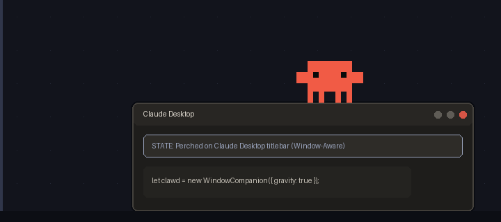

# Clawdlet

```ts
let clawd = new WindowCompanion({ gravity: true });
```

> ***`let clawd` roam on your Claude Desktop.***  
> **Clawdlet** — An unofficial, fan-made physics desktop pet that perches on your Claude Desktop window (`Claude.exe`).  
> **Clawdlet** —— 具備 2D 物理重力、視窗邊界感知（Window-Aware）且專屬於 Claude Desktop 桌面視窗的動態像素桌寵。



---

## ✨ Core Features | 核心特色

### 1. Window-Aware Claude Desktop Perching | 專屬視窗感知與標題列吸附
- **DWM Frame Tracking**: Automatically detects your active `Claude.exe` main window (supporting both Windows Store MSIX & standard Squirrel installs while filtering out background `claude-code` CLI processes) via `DWMWA_EXTENDED_FRAME_BOUNDS` with **0px gap** perching.
- **Autonomous Climbing & Strolling**: Clawdlet actively walks across your taskbar, climbs vertically up the side of your Claude Desktop window, and perches on top of the titlebar to peek down at your conversation.
- **Dynamic Window Physics**:
  - Smoothly follows the window when you drag Claude Desktop at normal speed.
  - Drops into free-fall (`FALLING` → `LAND_SQUISH`) if the window is minimized or closed.
  - Gets violently flung off along a ballistic arc (`THROWN` → `DIZZY` with orbiting stars) if you shake the Claude window rapidly!

### 2. Comedic Side-Profile Laptop Typing | 喜感側面掏筆電重摔打字 (`\_`)
- When Claude Desktop is actively thinking/generating—or when you **double-click** Clawdlet—it pulls a sleek `8×2` Ultrabook out of its belly, jumps high overhead, **slams the laptop down** into a side-profile `\_` shape with shockwave sparks, and stretches out **two long arms** to hammer away at the keyboard!

### 3. Mode-Dependent Laptop Put-Away & Cross-Screen Kick | 依模式分流的收筆電／踢飛大爆炸
- **Standard / Quiet Mode (`標準／安靜模式`)**: Neatly closes the `\_` laptop lid, picks up the folded Ultrabook, tucks it back into its belly, and pats its stomach (`put_away_laptop`).
- **Hyper Mode (`過動模式`)**: Winds up its front-left leg and **violently kicks the laptop all the way across your desktop into the left edge of your monitor (`x = 0`)**, triggering a **14-frame (1.75s) multi-stage pixel-art explosion** (electric short-circuit → 4-layer fireball & flying keycaps → chain-reaction cluster booms → billowing smoke plumes → 8-point anime golden star `★`)!

### 4. Native Win32 System Tray Control | 系統工作列圖示與穿透鎖定
- Lives quietly in the Windows System Tray (`clawdlet.ico`) with a full right-click menu:
  - **Summon to Center / Summon to Claude Window** (`一鍵召喚回畫面中央／Claude 視窗`)
  - **Activity Modes**: `Quiet (安靜)` / `Normal (標準)` / `Hyper (過動)`
  - **Pixel-Art Scaling**: `1x (64px)` / `2x (128px)` / `3x (192px)` anchored at feet level
  - **Click-Through Lock (`WS_EX_TRANSPARENT`)**: 100% mouse click pass-through so it never blocks your workflow

---

## 🚀 Quick Start | 快速開始

### Requirements | 環境需求
- **OS**: Windows 10 / 11 (64-bit, Per-Monitor DPI V2 supported)
- **Python**: Python 3.11+

### Installation & Run | 安裝與執行

```powershell
# Clone repository
git clone https://github.com/DreamOver9183/Clawdlet.git
cd Clawdlet

# Install in editable mode
pip install -e .

# Launch Clawdlet!
python -m clawdlet
```

### CLI Options | 命令列參數

```powershell
clawdlet --scale 2 --spawn claude          # Spawn above Claude Desktop at 2x (128x128) scale
clawdlet --mode hyper                      # Start directly in Hyper Mode (過動模式)
clawdlet --click-through                   # Start with mouse click-through lock enabled
clawdlet --debug                           # Show live state & HWND debug banner
clawdlet-dump-windows                      # Diagnostic tool to inspect detected Claude.exe HWNDs
```

### Build Standalone `clawdlet.exe` | 打包單一執行檔

```powershell
pip install pyinstaller
python -m clawdlet.tools.build_exe
# Output executable: dist/clawdlet.exe
```

---

## 🎮 Controls & Interactions | 互動操作一覽

| Input | Action | 操作說明 |
| :--- | :--- | :--- |
| **Left-Click + Drag** | Pick up & throw | 左鍵按住拎起掙扎，甩動放開可依滑鼠軌跡拋飛（高速落地會眼冒金星暈眩） |
| **Double Left-Click** | Toggle Laptop Typing | 左鍵雙擊切換「掏筆電重摔打字」，再次雙擊（或 6 秒後）觸發收筆電／踢飛筆電 |
| **Right-Click on Pet** | Playful Hop | 右鍵點擊角色觸發原地開心跳躍 |
| **Double-Click Tray Icon** | Summon to Center | 左鍵雙擊右下角系統匣圖示，立即將 Clawdlet 召喚回螢幕中央 |
| **Right-Click Tray Icon** | Open Control Menu | 右鍵點擊系統匣圖示，切換「安靜／標準／過動模式」、「1x/2x/3x 縮放」與「穿透鎖定」 |

---

## 🧪 Testing | 自動化測試

```powershell
pip install -e ".[dev]"
python -m pytest -v
```

---

## ⚖️ Legal Disclaimer & Dual-Licensing | 免責聲明與雙重授權

**Clawdlet** is an unofficial, non-commercial, fan-made open-source project.  
It is **NOT** affiliated with, endorsed by, or sponsored by Anthropic, PBC.

The "Claude" name, brand, and the original "Clawd" character concept are the intellectual property of Anthropic, PBC.
- **Source Code ([`LICENSE`](LICENSE))**: Licensed under the **MIT License**.
- **Sprite & Art Assets ([`assets/LICENSE.md`](assets/LICENSE.md))**: Explicitly excluded from the MIT License. All fan-made pixel-art assets in `assets/` are provided strictly for personal, non-commercial entertainment and educational use. Commercial redistribution, merchandise, or crypto/NFT usage is strictly prohibited.
