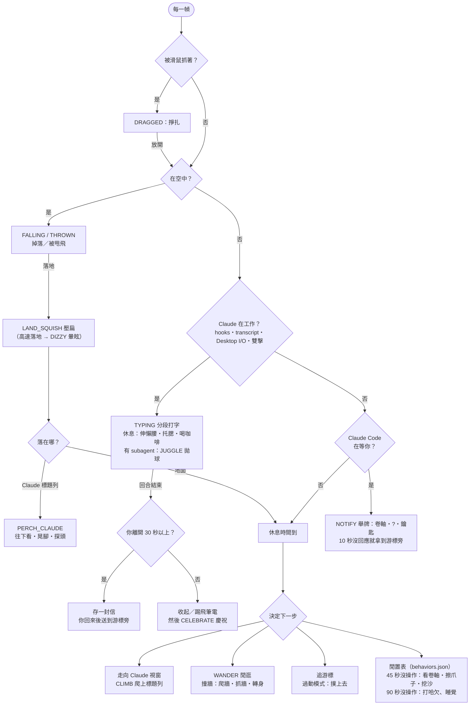

<p align="center"><a href="README.md">English</a> | <b>繁體中文</b></p>

# Clawdlet

```ts
let clawd = new WindowCompanion({ gravity: true });
```

> ***`let clawd` roam on your Claude Desktop.***
> **Clawdlet** —— 具備 2D 物理重力、視窗邊界感知（Window-Aware），專屬於 Claude Desktop 視窗（`Claude.exe`）的非官方同人像素桌寵。


---

## ✨ 介紹

Clawdlet 是一隻住在 Windows 桌面上的像素風小 Clawd。牠有重力，知道你的 Claude Desktop 視窗在哪裡，也會跟著 Claude 正在做的事做出反應。

<table>
  <tr>
    <td align="center"><br><sub>在工作列上閒逛</sub></td>
    <td align="center"><br><sub>爬上 Claude 視窗坐好</sub></td>
    <td align="center"><br><sub>Claude 工作時掏筆電打字</sub></td>
    <td align="center"><br><sub>拎起來甩出去會暈</sub></td>
  </tr>
  <tr>
    <td align="center"><br><sub>滑鼠來回摩擦就是摸摸</sub></td>
    <td align="center"><br><sub>subagent 在跑時拋球</sub></td>
    <td align="center"><br><sub>Claude 需要你時舉牌</sub></td>
    <td align="center"><br><sub>你不在時打瞌睡</sub></td>
  </tr>
</table>

- **視窗感知**：找到 Claude Desktop 視窗、走過去、沿著側邊爬上去坐在標題列上。拖動視窗牠會跟著走，猛甩視窗會把牠甩飛，最小化視窗牠就掉下來。
- **Claude 工作時牠也工作**：Claude 思考中（Claude Desktop 的 I/O、Claude Code 的 hooks 或 transcript），Clawd 會掏出筆電一段一段地打字、中間休息，回合結束就慶祝。過動模式下會把筆電一腳踢到螢幕邊緣爆炸。
- **對你有反應**：眼睛跟著游標轉；可以戳、摸、拎起來甩；90 秒沒碰鍵盤滑鼠就睡著。
- **Claude Code 連動**：subagent 在跑時拋球、壓縮對話時蛻殼、工具失敗時困惑／冒汗／沮喪；plan 審核、發問、工具授權時舉牌提醒；你不在時做完的回合，回來後牠會送信給你。
- **可自訂**：三種活躍度模式、1x／2x／3x 縮放、點擊穿透鎖定，以及用 JSON 行為表調整閒置行為。

完整說明：**[功能細節](docs/features.zh-TW.md)** · **[Claude Code hooks](docs/claude-code-hooks.zh-TW.md)** · **[行為設定檔](docs/behavior-config.zh-TW.md)**

---

## 🧠 行為邏輯

Clawd 每一幀（60 FPS）由上往下檢查以下條件。你的互動（戳、摸、拖曳、連點）隨時可以插隊。



休息結束時，下一步依這個順序決定：通知 > 送信 > 慶祝 > 工作 > 邊緣躲藏 > 推視窗 > 追游標 > 找 Claude > 閒逛 > 閒置表。

---

## 🚀 快速開始

**環境需求**：Windows 10／11（64 位元）、Python 3.11 以上

```powershell
git clone https://github.com/DreamOver9183/Clawdlet.git
cd Clawdlet
pip install -e .
python -m clawdlet
```

Clawd 會登場（掉到 Claude 標題列上、從螢幕頂端掉下，或從側邊走進來），系統匣也會出現圖示。

選用：連動 Claude Code，讓 Clawd 對你的 agent 有反應。監看 session transcript 不用任何設定；想要完整反應，可以從系統匣選單安裝 hooks，或執行：

```powershell
clawdlet --install-hooks
```

<details>
<summary>打包單一執行檔 <code>clawdlet.exe</code></summary>

```powershell
pip install pyinstaller
python -m clawdlet.tools.build_exe
# 輸出：dist/clawdlet.exe
```

</details>

---

## 🎮 操作說明

### 滑鼠

| 操作 | 效果 |
| :--- | :--- |
| **左鍵按住拖曳** | 拎起來甩出去（高速落地會眼冒金星） |
| **單擊** | 戳一下（睡著會嚇醒；頭上有「!」時代表已讀；打字時只會抬頭看你一眼） |
| **雙擊** | 切換掏筆電打字 |
| **連點三下以上** | 抓狂跺腳 |
| **滑鼠在身上來回摩擦** | 摸摸（冒愛心） |
| **游標靠近** | 眼睛追著看、偶爾走到游標下方；過動模式會撲上去 |
| **右鍵點 Clawd** | 開心跳一下 |
| **點信封** | 收信，Claude Desktop 會跳到前景 |
| **點舉著牌子的 Clawd** | Claude Desktop 會跳到前景 |

### 系統匣

雙擊系統匣圖示可以把 Clawd 召喚回來。右鍵選單包含：

- **召喚回畫面中央**／**召喚至 Claude 視窗**
- **掏出筆電打字**：和雙擊 Clawd 一樣
- **邊緣躲藏**、**允許推視窗**（過動模式）
- **離開時送信**、**打字時聆聽**、**需要我時通知**（預設開啟）
- **安裝 Claude Code hooks**（已安裝時打勾，再點一次就移除；舊版安裝會顯示 **更新 Claude Code hooks**）、**複製 Claude Code hook 設定**
- **重新載入行為設定**、**開啟設定資料夾**
- **活躍度**：安靜／標準／過動模式
- **縮放比例**：1x（64 px）／2x（128 px）／3x（192 px）
- **穿透鎖定模式**：滑鼠點擊會穿過 Clawd
- **顯示除錯資訊**
- **結束 Clawdlet**（Clawd 會先揮手道別）

### 命令列參數

```powershell
clawdlet --scale 2 --spawn above-claude    # 以 2 倍大小出現在 Claude Desktop 上方（預設：隨機登場）
clawdlet --spawn center                    # 出現在螢幕中央
clawdlet --mode hyper                      # 以過動模式啟動（quiet / normal / hyper）
clawdlet --click-through                   # 啟動時開啟穿透鎖定
clawdlet --debug                           # 顯示即時狀態與 HWND 除錯列
clawdlet --install-hooks                   # 把 Clawdlet 的 hooks 加進 ~/.claude/settings.json（會先備份）
clawdlet --uninstall-hooks                 # 移除 hooks（會先備份）
clawdlet --print-hook-config               # 印出 hooks 設定，自行合併
clawdlet --hook-port 47821                 # hook 接收器的 port（預設 47821）
clawdlet --no-hooks                        # 不啟動 hook 接收器
clawdlet --no-transcript-watch             # 不監看 Claude Code transcript
clawdlet --allow-window-push               # 過動模式可以把 Claude 視窗推幾個像素
clawdlet --no-mail                         # 你不在時也直接慶祝，不送信
clawdlet --no-listen                       # 你在 Claude Desktop 打字時不歪頭聆聽
clawdlet --no-notify                       # plan 審核／發問／工具授權時不舉牌
clawdlet --behaviors D:\my-behaviors.json  # 改用這個行為覆寫檔
clawdlet --dump-behaviors                  # 印出合併後的行為表後結束
clawdlet-dump-windows                      # 診斷偵測到哪些 Claude.exe 視窗
```

---

## 📚 文件

| 文件 | 內容 |
| :--- | :--- |
| [功能細節](docs/features.zh-TW.md) | 所有行為的完整說明：視窗追蹤、工作段、反應、閒置分層、登場、送信、傾聽、通知 |
| [Claude Code hooks](docs/claude-code-hooks.zh-TW.md) | hook 事件、三種連動方式、接收器的隱私與安全 |
| [行為設定檔](docs/behavior-config.zh-TW.md) | `behaviors.json` 格式，用來調整或新增閒置行為 |
| [開發](docs/development.zh-TW.md) | 測試、打包 exe、sprite 與 GIF 產生器、開發工具 |
| [專案概念書](docs/clawdlet.md) | 最初的設計文件、狀態機與里程碑 |

---

## 🙏 銘謝

Clawdlet 的行為設計受到 **Shimeji-ee**、**Microsoft Agent**、**oneko**、**eSheep**、**VPet**、**clawd-on-desk**、**Desktop Goose** 等專案啟發。只參考了設計概念，沒有使用它們的程式碼或素材。各項參考的來源見 **[docs/ACKNOWLEDGEMENTS.md](docs/ACKNOWLEDGEMENTS.md)**。

---

## ⚖️ 免責聲明與雙重授權

**Clawdlet** 是非官方、非商業的同人開源專案，與 Anthropic, PBC **沒有任何關係**，也未經其認可或贊助。

「Claude」名稱、品牌與「Clawd」角色的原始概念屬於 Anthropic, PBC 的智慧財產。

- **程式碼（[`LICENSE`](LICENSE)）**：MIT 授權。
- **Sprite 與美術素材（[`assets/LICENSE.md`](assets/LICENSE.md)）**：不適用 MIT 授權。`assets/` 內的同人像素圖僅供個人、非商業的娛樂與學習使用，禁止商業再散布、製作周邊或用於加密貨幣／NFT。
